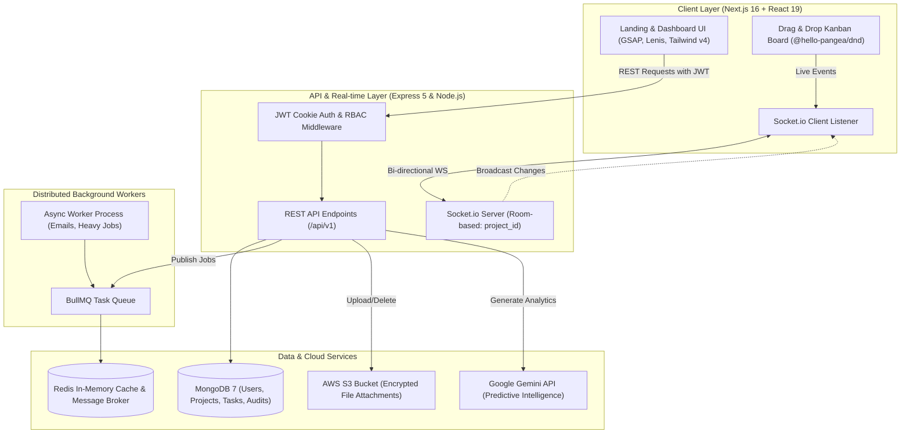
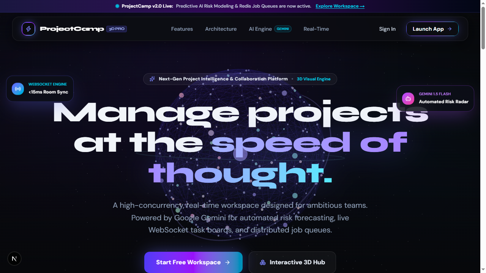
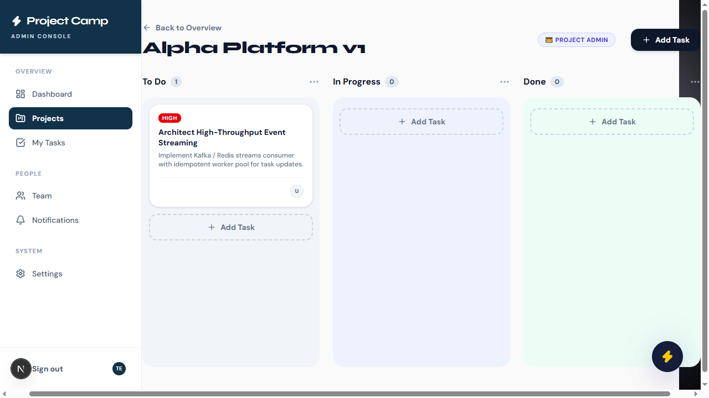
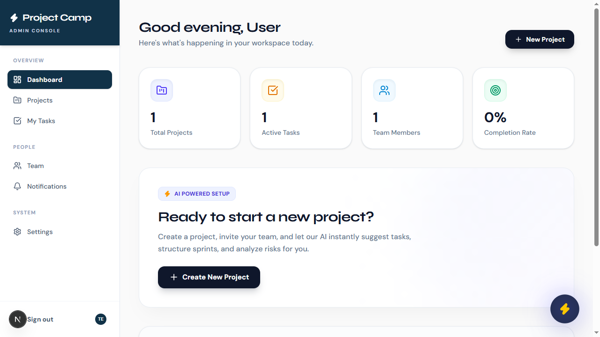
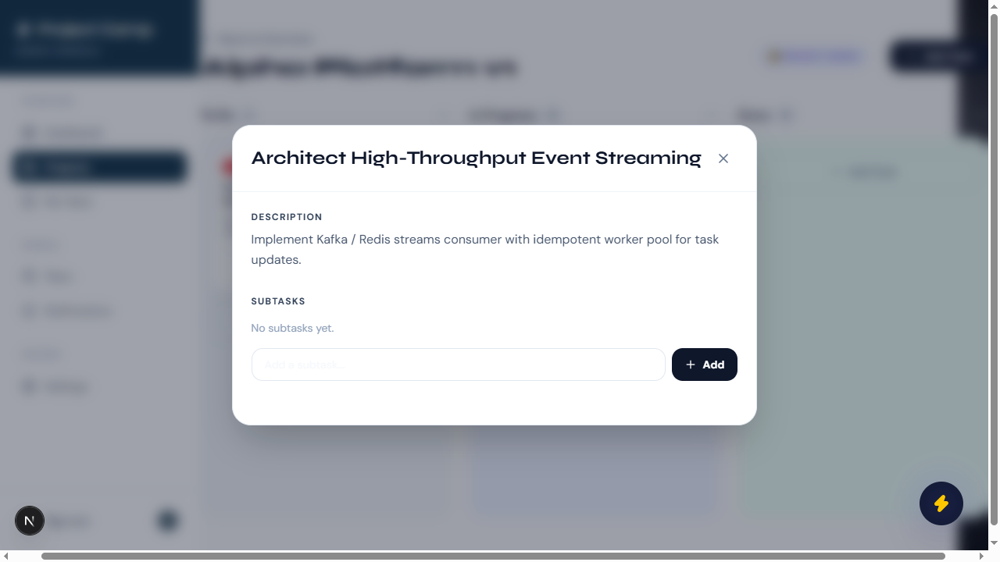
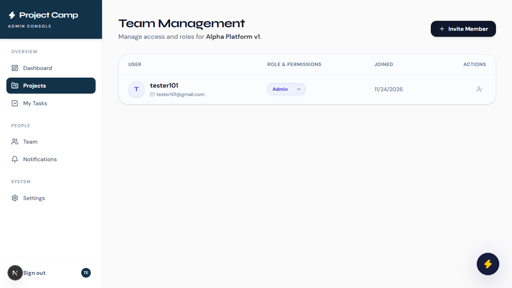
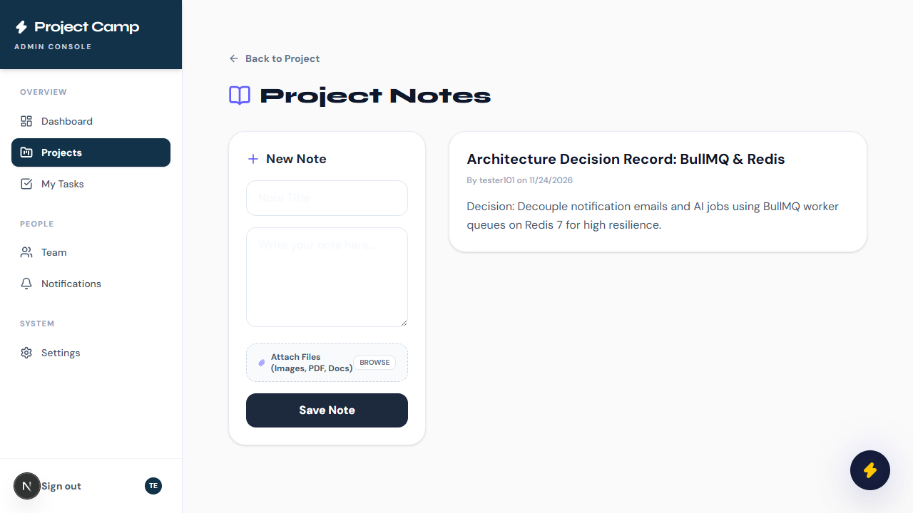

# 🚀 ProjectCamp — Enterprise Real-Time Project Management & AI Platform

[](https://nextjs.org/)
[](https://react.dev/)
[](https://www.typescriptlang.org/)
[](https://nodejs.org/)
[](https://expressjs.com/)
[](https://www.mongodb.com/)
[](https://redis.io/)
[](https://socket.io/)
[](https://aws.amazon.com/s3/)
[](https://ai.google.dev/)
[](https://opensource.org/licenses/MIT)

**ProjectCamp** is a high-concurrency, full-stack collaborative project management platform inspired by Linear, Jira, and Asana. It is engineered with real-time WebSocket synchronization, role-based access control (RBAC), distributed job queues, cloud file storage, and predictive AI capabilities powered by Google Gemini.

---

## 🏗️ System Architecture



---

## ✨ Key Engineering Highlights

### ⚡ 1. Real-Time Synchronization (Socket.io)
- **Room-Based Isolation:** Users automatically subscribe to isolated project channels (`project_${projectId}`), eliminating cross-tenant broadcast noise and maximizing scalability.
- **Instant Board Updates:** Task creation, drag-and-drop state transitions, assignments, and deletions reflect live across all connected clients without page reloads.

### 🤖 2. Predictive AI Assistant (Google Gemini)
- **Automated Risk Assessment:** Analyzes overdue tasks, bottlenecks, and velocity to compute a comprehensive project health score and mitigation strategy.
- **Smart Workload Balancing:** Evaluates active workload per team member to recommend optimal task distribution.
- **Timeline & Milestone Prediction:** Uses statistical task data and historical progress to compute optimistic, realistic, and pessimistic completion dates.
- **Smart Task Generation:** Generates contextual user stories, acceptance criteria, and subtasks tailored to the project domain.

### 🛡️ 3. Security, RBAC & Audit Trails
- **Granular RBAC:** Complete segregation between **Admins** and **Members** with custom permission flags (`canCreateTasks`, `canEditTasks`, `canDeleteTasks`, `canManageMembers`).
- **Comprehensive Audit Trail (`ActivityLog`):** Non-blocking asynchronous logging of user actions, IP addresses, user agents, and mutation diffs.
- **Secure Token Flow:** HttpOnly, SameSite cookies for access and refresh tokens, mitigating XSS and CSRF vectors.

### 📦 4. Background Queues & Storage
- **BullMQ + Redis:** Non-blocking async queue offloads resource-heavy operations (welcome emails, AI processing, bulk operations) from the HTTP event loop.
- **AWS S3 File Pipeline:** Multi-file attachments uploaded directly via presigned buffers with automated S3 deletion hooks on task cleanup.

---

## 📸 Application Screenshots & UI Showcase

| 🌟 Cyber-Obsidian 3D Hero Experience | 📋 Real-Time Drag & Drop Kanban |
| :---: | :---: |
|  |  |

| 📊 Workspace Telemetry & Analytics | 🔍 Granular Task & Subtask Modal |
| :---: | :---: |
|  |  |

| 👥 Team Management & RBAC Permissions | 📝 Project Notes with Multi-File Uploads |
| :---: | :---: |
|  |  |

---

## 🛠️ Tech Stack & Technologies

| Layer | Technologies |
| :--- | :--- |
| **Frontend** | Next.js 16 (App Router), React 19, TypeScript, Tailwind CSS v4, GSAP 3, Lenis, Three.js, Lucide Icons |
| **Backend** | Node.js, Express.js 5, Socket.io 4, Mongoose 9, Winston Logger, Multer-S3 |
| **Database & Cache** | MongoDB 7, Redis 7 (In-memory storage & queue broker) |
| **Queue Engine** | BullMQ (Distributed message processing) |
| **Cloud & AI** | Google Gemini Generative AI, OpenAI SDK, AWS S3, Mailtrap / Nodemailer |
| **DevOps & Tooling** | Docker, Docker Compose, Git, Prettier, ESLint |

---

## 🚀 Quick Start Guide

### 1. Prerequisites
- [Node.js](https://nodejs.org/) (v20+ recommended)
- [Docker & Docker Compose](https://www.docker.com/)
- [Git](https://git-scm.com/)

### 2. Clone the Repository
```bash
git clone https://github.com/nimranaz148/project-management-system.git
cd project-management-system
```

### 3. Spin up Infrastructure (MongoDB + Redis)
```bash
docker compose up -d
```
> This starts **MongoDB** on `localhost:27017`, **Mongo Express** GUI on `localhost:8081`, and **Redis** on `localhost:6379`.

### 4. Configure Environment Variables
Copy the sample environment files and configure your keys:
```bash
# Backend configuration
cp .env.example .env

# Frontend configuration
cp frontend/.env.example frontend/.env.local
```

### 5. Install Dependencies & Start

#### Backend:
```bash
npm install
npm run dev
# Backend runs on http://localhost:8000
```

#### Frontend:
```bash
cd frontend
npm install
npm run dev
# Frontend runs on http://localhost:3000
```

---

## 📡 API Endpoint Overview

| Method | Endpoint | Description | Auth |
| :--- | :--- | :--- | :--- |
| `POST` | `/api/v1/auth/register` | Register a new user | Public |
| `POST` | `/api/v1/auth/login` | Authenticate user & issue JWT cookie | Public |
| `POST` | `/api/v1/auth/current-user` | Fetch current session profile | User |
| `GET` | `/api/v1/project` | List user's active projects | User |
| `POST` | `/api/v1/project` | Create a new project | User |
| `GET` | `/api/v1/project/:projectId` | Get detailed project specs | Member |
| `GET` | `/api/v1/tasks/:projectId` | List all tasks in a project | Member |
| `POST` | `/api/v1/tasks/:projectId` | Create task with S3 attachments | Member (RBAC) |
| `PUT` | `/api/v1/tasks/:projectId/:taskId` | Update task status, priority, or details | Member |
| `DELETE`| `/api/v1/tasks/:projectId/:taskId` | Delete task & cascade S3 files | Admin |
| `POST` | `/api/v1/ai/suggest-tasks/:projectId` | AI task suggestion engine | Member |
| `GET` | `/api/v1/ai/analyze-risks/:projectId` | AI risk analysis & health report | Member |
| `GET` | `/api/v1/ai/predict-timeline/:projectId` | AI project completion timeline forecast | Member |
| `GET` | `/api/v1/notifications` | Fetch unread in-app notifications | User |

---

## 📄 License
This project is open-source under the [MIT License](LICENSE).
